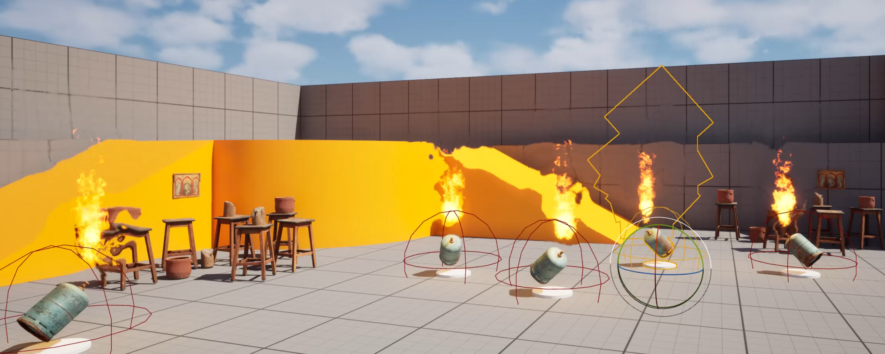
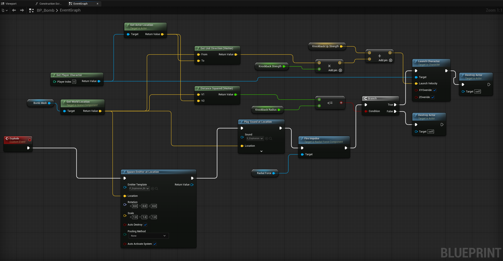
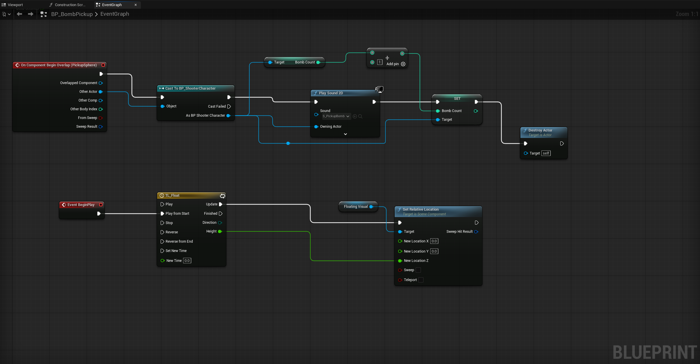

# Bomb — Unreal Engine

A bomb system created in Unreal Engine as part of the **LABA IT — Unreal Engine — C++** course. This repository showcases the project through a demonstration video and screenshots of its Blueprint logic.

**Author:** Joanna Strzeszewska

## Demo Video

[▶ Watch the demo on YouTube](https://youtu.be/xnBEjKRdFk8)

The video demonstrates collecting pickups, updating the bomb counter, and detonating bombs in different scenarios.

## Features

- Place bombs using an assigned input action.
- Track the number of available bombs with the `BombCount` variable.
- Collect pickups to replenish bombs.
- Display the bomb counter in the player interface.
- Rotating, floating pickups with visual effects and sound.
- Delayed bomb detonation with a defined blast radius.
- Destruction of objects set up as Geometry Collections.
- Explosion impulses affecting physics-enabled objects.
- Knockback for the player within the blast radius.
- Automatic removal of bombs after detonation and pickups after collection.

## Scene Preview

## Blueprints

### BP_Bomb — Detonation and Player Knockback

The `Explode` event spawns a particle effect, plays a sound, and fires an impulse from the `RadialForce` component. The graph compares the squared distance between the bomb and the player against `KnockbackRadius` to decide whether to apply knockback using `Launch Character`. The launch velocity combines a direction vector scaled by `KnockbackStrength` with `KnockbackUpStrength`. The bomb is destroyed after the explosion.

### BP_BombPickup — Collection and Animation

When a `BP_ShooterCharacter` overlaps `PickupSphere`, the Blueprint plays a sound, increases `BombCount` by 1, and destroys the pickup. The `TL_Float` timeline changes the Z position of the `FloatingVisual` component to create a floating effect, while the `RotatingMovement` component handles rotation.

## Repository Contents

This repository contains visual documentation and a link to the demo video. It does not include a `.uproject` file, `.uasset` files, or C++ source code, so it cannot be opened as an Unreal Engine project.

